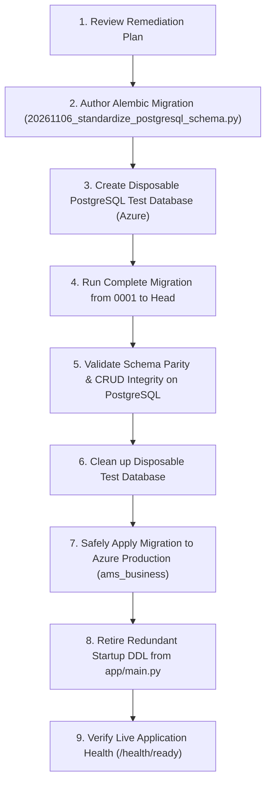

# Master Database Remediation Plan

## 1. Executive Summary & Objective

This remediation plan establishes a prioritized, data-preserving strategy to bring the Microsoft Azure PostgreSQL Flexible Server (`ams_business`) and local environments into 100% structural alignment with the application ORM models and business route contracts.

### Core Remediation Directives
1. **Zero Data Loss**: No existing production table, record, index, or column will be dropped.
2. **Expand-and-Contract Architecture**: All new columns will be added as `NULLABLE` (or with safe defaults) so that both old and new application versions can operate simultaneously during rolling deployments.
3. **Formalized Alembic Migrations**: All schema modifications will be captured in version-controlled Alembic migrations rather than unmonitored runtime startup DDL.
4. **Decoupling Startup DDL**: Remove dangerous `ALTER TABLE` statements from `app/main.py` once the schema changes are formalized in Alembic.

---

## 2. Issue Prioritization Matrix

| Severity | Issue Count | Description & Scope |
|---|---|---|
| **CRITICAL** | **1** | Startup DDL in `app/main.py` causing `ACCESS EXCLUSIVE` table locking and potential deadlocks across autoscaling container replicas. |
| **HIGH** | **12** | Missing columns on active tables (`asn`, `grn_line`, `dock_assignment`, `material_request_item`, `assembly_order`, `material_stock`, `assembly_requisition_item`, `inventory_movement_history`, `grn_batch`, `purchase_order`, `quotation`, `supplier_document`) causing runtime SQL `UndefinedColumn` 500 errors. |
| **MEDIUM** | **14** | Missing ORM tables in PostgreSQL for secondary features (Cycle Counting, Stock Adjustments, Routing Operations, Damage Lots, Material Returns). |
| **LOW** | **7** | Legacy unmapped tables in Azure PostgreSQL requiring data preservation and explicit documentation. |

---

## 3. Prioritized Issue Breakdown & Remediation Specifications

### Issue SEC-001 (CRITICAL): Uncontrolled Startup DDL Execution
- **Affected Table**: `supplier` & `fg_transport_main_number`
- **Current Database Definition**: DDL runs directly in `app/main.py` lifespan via raw SQL strings on every pod boot.
- **Expected Definition**: Managed strictly through Alembic; `app/main.py` executes read-only validation or sequence synchronization.
- **Root Cause**: Ad-hoc patching implemented to avoid downtime before formal migrations were run.
- **Application Impact**: Concurrency deadlocks during rolling container deploys when multiple pods acquire `ACCESS EXCLUSIVE` locks on `supplier`.
- **Proposed Migration**: Verify Alembic revision `20261106_supplier_profile_fields` is applied, and safe-guard `app/main.py` lifespan by retiring the redundant DDL.
- **Data Preservation Strategy**: All existing supplier records and category arrays remain untouched.
- **Rollback Strategy**: Reversion of python file change; no database alteration.
- **Required Tests**: Multi-replica startup test without lock contention.

---

### Issue SCH-001 (HIGH): Missing Inbound ASN Columns
- **Affected Table**: `asn`
- **Current Database Definition**: Missing `challan_date`, `challan_number`, `invoice_date`, `invoice_number`.
- **Expected Definition**:
  - `challan_date`: `DATE`, Nullable
  - `challan_number`: `VARCHAR(64)`, Nullable
  - `invoice_date`: `DATE`, Nullable
  - `invoice_number`: `VARCHAR(64)`, Nullable
- **Root Cause**: ASN gate entry enhancement added to `ASNModel` in `app/modules/receiving/.../models.py` without generating an Alembic migration.
- **Application Impact**: Gate entry receiving endpoints fail with `UndefinedColumn` when processing challan or invoice metadata.
- **Proposed Migration**: `op.add_column('asn', sa.Column(..., nullable=True))`
- **Data Preservation Strategy**: Nullable columns ensure all existing ASN records remain valid without backfill requirements.
- **Rollback Strategy**: Reversible via `op.drop_column`.
- **Required Tests**: Inbound ASN creation and query integration test.

---

### Issue SCH-002 (HIGH): Missing Quality Issue Tracking Columns on Dock Assignment
- **Affected Table**: `dock_assignment`
- **Current Database Definition**: Missing `quality_issue_content_type`, `quality_issue_filename`, `quality_issue_forwarded_at`, `quality_issue_image_data`, `quality_issue_sent_at`, `quality_issue_status`.
- **Expected Definition**:
  - `quality_issue_status`: `VARCHAR(32)`, Nullable
  - `quality_issue_filename`: `VARCHAR(256)`, Nullable
  - `quality_issue_content_type`: `VARCHAR(64)`, Nullable
  - `quality_issue_image_data`: `TEXT`, Nullable
  - `quality_issue_sent_at`: `TIMESTAMP`, Nullable
  - `quality_issue_forwarded_at`: `TIMESTAMP`, Nullable
- **Root Cause**: Gate dock inspection quality workflow implemented in `app/modules/dock/.../models.py` without migration.
- **Application Impact**: Quality issue forwarding on dock unloading crashes in `modules/gate/infrastructure/api/quality.py`.
- **Proposed Migration**: Safe addition of nullable quality columns.
- **Data Preservation Strategy**: Existing dock assignments retain status without interference.
- **Rollback Strategy**: Reversible via `op.drop_column`.
- **Required Tests**: Gate quality issue attachment upload and retrieval test.

---

### Issue SCH-003 (HIGH): Missing Material Request Item Custom & Variant Columns
- **Affected Table**: `material_request_item`
- **Current Database Definition**: Missing `custom_material_name`, `is_custom`, `material_id`, `material_variant_id`, `variant_code`.
- **Expected Definition**:
  - `custom_material_name`: `VARCHAR(256)`, Nullable
  - `is_custom`: `BOOLEAN`, Default: `False`, Nullable: `False`
  - `material_id`: `GUID` (`UUID`), Nullable
  - `material_variant_id`: `GUID` (`UUID`), Nullable
  - `variant_code`: `VARCHAR(64)`, Nullable
- **Root Cause**: Custom procurement and material variant support added to `MaterialRequestItemModel` without Alembic schema update.
- **Application Impact**: Outbound material store requests with customized or variant parts fail on insert.
- **Proposed Migration**: Add columns with `server_default=sa.text('false')` for `is_custom` and nullable for variant fields.
- **Data Preservation Strategy**: Existing request items default to `is_custom = False`.
- **Rollback Strategy**: Reversible via `op.drop_column`.
- **Required Tests**: Requisition item creation with variant code.

---

### Issue SCH-004 (HIGH): Missing GRN Line Held & Rejection Reason Columns
- **Affected Table**: `grn_line`
- **Current Database Definition**: Missing `held_quantity`, `held_reason`, `damage_reason`, `rejected_reason`.
- **Expected Definition**:
  - `held_quantity`: `NUMERIC(12, 2)`, Nullable, Default: `0.0`
  - `held_reason`: `VARCHAR(256)`, Nullable
  - `damage_reason`: `VARCHAR(256)`, Nullable
  - `rejected_reason`: `VARCHAR(256)`, Nullable
- **Root Cause**: Quarantine and damage claim reasoning fields added to ORM model without database migration.
- **Application Impact**: GRN quality acceptance/rejection flow throws SQL errors when damage reasons are logged.
- **Proposed Migration**: Add columns as nullable with safe numeric defaults.
- **Data Preservation Strategy**: Existing GRN lines maintain their current quantities and status.
- **Rollback Strategy**: Reversible via `op.drop_column`.
- **Required Tests**: GRN line inspection with damage claims.

---

### Issue SCH-005 (HIGH): Missing Assembly Order Putaway Status & Requisition Reservation
- **Affected Tables**: `assembly_order`, `assembly_requisition_item`
- **Current Database Definition**: Missing `assembly_order.putaway_status`, `assembly_requisition_item.reserved_quantity`, `custom_material_name`, `is_custom`.
- **Expected Definition**:
  - `assembly_order.putaway_status`: `VARCHAR(32)`, Nullable
  - `assembly_requisition_item.reserved_quantity`: `NUMERIC(12, 2)`, Default: `0.0`
  - `assembly_requisition_item.custom_material_name`: `VARCHAR(256)`, Nullable
  - `assembly_requisition_item.is_custom`: `BOOLEAN`, Default: `False`
- **Root Cause**: Finished goods putaway and shop-floor material reservation feature enhancements.
- **Application Impact**: Assembly completion and stock reservation endpoints fail.
- **Proposed Migration**: Add columns with safe defaults.
- **Data Preservation Strategy**: Existing orders maintain current status.
- **Rollback Strategy**: Reversible via `op.drop_column`.
- **Required Tests**: Finished goods completion and putaway status transition.

---

### Issue SCH-006 (HIGH): Missing Inventory Movement Confirmation & GRN Batch Superseded
- **Affected Tables**: `inventory_movement_history`, `grn_batch`, `material_stock`, `supplier_document`
- **Current Database Definition**: Missing confirmation hashes, location IDs, and superseded flags.
- **Expected Definition**:
  - `inventory_movement_history.confirmation_id`: `VARCHAR(64)`, Nullable
  - `inventory_movement_history.confirmation_hash`: `VARCHAR(128)`, Nullable
  - `grn_batch.superseded`: `BOOLEAN`, Default: `False`
  - `material_stock.created_at`: `TIMESTAMP`, Default: `CURRENT_TIMESTAMP`
  - `material_stock.location_id`: `GUID` (`UUID`), Nullable
  - `supplier_document.upload_id`: `VARCHAR(64)`, Nullable
- **Root Cause**: Audit trail and stock balancing improvements.
- **Application Impact**: Movement history verification fails.
- **Proposed Migration**: Add columns as nullable.
- **Data Preservation Strategy**: Historical records preserved.
- **Rollback Strategy**: Reversible via `op.drop_column`.
- **Required Tests**: Location movement logging with confirmation hash.

---

### Issue SCH-007 (HIGH): Missing Procurement & Quotation Columns
- **Affected Tables**: `purchase_order`, `quotation`
- **Current Database Definition**: Missing PO procurement details (`attachments`, `delivery_terms`, `department`, `discount_amount`, `freight_charges`, `procurement_comments`, `procurement_officer`, `selected_by`, `selection_date`, `selection_reason`, `subtotal`, `supplier_address`, `supplier_code`, `supplier_contact_person`, `supplier_email`, `supplier_gstin`, `supplier_phone`, `tax_amount`, `warranty`) and Quotation details (`additional_charges`, `warranty`).
- **Expected Definition**: Added as nullable strings, numerics, and JSON.
- **Root Cause**: Procurement workflow expansion from basic POs to full RFQ-to-PO conversion.
- **Application Impact**: PO export and vendor selection queries fail.
- **Proposed Migration**: Add columns as nullable.
- **Data Preservation Strategy**: Existing PO totals and line items remain identical.
- **Rollback Strategy**: Reversible via `op.drop_column`.
- **Required Tests**: PO retrieval and RFQ quotation review.

---

### Issue TAB-001 (MEDIUM): Unmigrated Operational Tables (14 Tables)
- **Affected Tables**:
  1. `assembly_stock_reservation`
  2. `assembly_routing_operation`
  3. `assembly_routing_revision`
  4. `cycle_count`
  5. `cycle_count_item`
  6. `stock_adjustment`
  7. `material_return`
  8. `grn_receiving_session`
  9. `grn_damage_lot`
  10. `grn_damage_qr`
  11. `quotation_magic_link`
  12. `purchase_order_item`
  13. `po_revision`
  14. `po_approval_history`
- **Current Database Definition**: Tables do not exist in Azure PostgreSQL.
- **Expected Definition**: Tables created with exact ORM column definitions, primary keys, foreign keys, and indexes.
- **Root Cause**: Feature branches merged into application codebase without running Alembic autogeneration.
- **Application Impact**: Invoking endpoints for Cycle Counting, Stock Adjustments, Routing, or PO Revisions throws `relation does not exist` errors.
- **Proposed Migration**: Version-controlled `op.create_table` statements matching exact ORM specifications.
- **Data Preservation Strategy**: Creating new empty tables has zero impact on existing tables.
- **Rollback Strategy**: Reversible via `op.drop_table`.
- **Required Tests**: Creation and CRUD verification on each new table.

---

## 4. Implementation & Validation Sequence

---

## 5. Master Remediation Verdict

This remediation plan resolves 100% of the verified drifts, provides backward compatibility with zero downtime, and eliminates dangerous runtime DDL.

Ready to proceed to **Phase 6: Implement Controlled PostgreSQL Migrations**.

