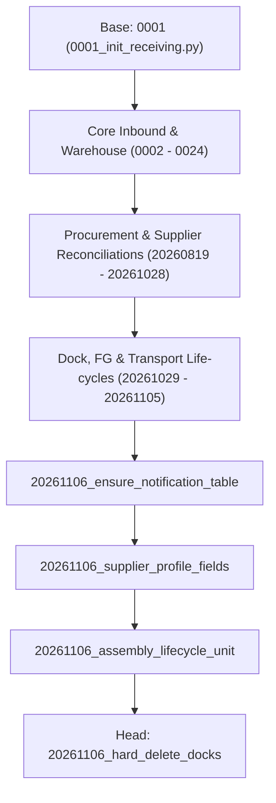

# PostgreSQL Migration History & Integrity Report

## 1. Executive Summary & Audit Scope

This report audits the entire Alembic migration DAG for the Kaizen Warehouse Management System (`ams-wms-business-service`).

The migration history comprises **166 revision files** extending from the initial baseline (`0001_init_receiving.py`) to the current active head (`20261106_hard_delete_docks.py`).

---

## 2. Migration DAG & Lineage Verification

### 2.1 DAG Topology & Head Count
- **Total Migration Files**: 166
- **Alembic Bases**: `['0001']`
- **Alembic Heads**: `['20261106_hard_delete_docks']` (Exactly **1 single head**; zero multiple heads or orphaned branches).
- **Azure PostgreSQL Recorded Version**: `['20261106_hard_delete_docks']`.
- **Verdict**: The database recorded version matches the repository migration head. There are no pending unapplied migrations in the existing 166-file DAG.

---

## 3. Historical Integrity & Destructive Operation Analysis

An AST analysis of all 166 migration scripts evaluated `upgrade()` and `downgrade()` routines:

### 3.1 Destructive Operations in `upgrade()`
Only 7 historical migrations in the repository executed destructive `drop_column` or `drop_table` operations, all associated with intentional architectural retirements:
1. `0009_update_dock_only.py`: Dropped legacy capacity columns on dock masters.
2. `1f68ebae7969_simplify_purchase_order_lines_to_only_.py`: Simplified legacy PO line structures.
3. `20260904_remove_store_from_material_request.py`: Removed deprecated store foreign keys.
4. `20261015_remove_customer_orders.py`: Retired customer order mock tables.
5. `20261028_remove_user_store_assignment.py`: Retired store manager ownership.
6. `80f7621726bc_remove_purchase_order_module_and_.py`: Decoupled legacy PO constraints.
7. `e97285d0f31b_remove_department_and_procurement_.py`: Removed temporary procurement columns.

### 3.2 Downgrade Behavior (Forward-Only Migrations)
- **108 migrations** provide inverse drop operations for local testing environments.
- **57 migrations** explicitly designate themselves as **forward-only** (`raise RuntimeError("... forward-only ...")`), preserving production business data. In an enterprise system with live historical records, dropping populated columns or dismantling normalized JSON structures would discard business data.

---

## 4. Root Cause of Missing Tables and Schema Drift

If the Alembic DAG converges cleanly at `20261106_hard_delete_docks` and Azure PostgreSQL is at that exact head, why do 14 tables and several columns drift from the ORM models?

### Root Cause Analysis
1. **Model-First Feature Authoring Without Migration Generation**:
   Several modules (e.g. Cycle Counting, Stock Adjustment, Material Return in `app/modules/storage`, Routing Operations in `app/modules/assembly`, and Purchase Order Item tracking in `app/common/persistence`) were developed by declaring SQLAlchemy models and writing use cases against them, without running `alembic revision --autogenerate`.
2. **Local SQLite Development Fallback**:
   In SQLite or mock environments, engineers occasionally used `Base.metadata.create_all()` which created all 111 tables on the fly, concealing the fact that no version-controlled Alembic migration script had ever been authored for them.
3. **Ad-Hoc Lifespan DDL**:
   When columns were found missing in staging/dev (such as on the `supplier` table), engineers injected raw `ALTER TABLE` statements into the FastAPI lifespan startup routine in `app/main.py` rather than publishing an Alembic migration.

---

## 5. Migration Integrity Verdict

- **DAG Structure**: Valid and continuous.
- **Single Head**: Verified at `20261106_hard_delete_docks`.
- **Database Parity**: Azure PostgreSQL is confirmed to have executed all 166 existing migrations.
- **Remediation Requirement**: A new, consolidated, version-controlled forward migration (`20261106_standardize_postgresql_schema.py`) must be authored to:
  1. Create the 14 unmigrated ORM tables with proper primary keys, foreign keys, and indexes.
  2. Add the missing columns to the 12 existing tables with safe nullability and defaults.
  3. Formally absorb the startup DDL on `supplier` and `fg_transport_main_number` into Alembic.

