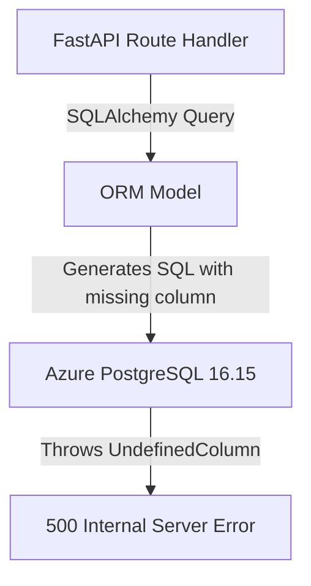

# PostgreSQL Schema Drift Report

## 1. Executive Summary & Scope

This report provides a comprehensive, field-by-field schema drift analysis comparing:
1. **Application ORM Models**: 111 registered SQLAlchemy models across 15 domain modules.
2. **Repository Migration History**: 166 Alembic migration scripts converging at revision `20261106_hard_delete_docks`.
3. **Azure PostgreSQL Flexible Server**: Live schema of `ams_business` (`PostgreSQL 16.15`).
4. **Application Code Usage**: Route queries, repository commands, and DTO contracts.

---

## 2. Table Drift Classification Overview

| Classification Category | Table Count | Architectural Definition & Impact |
|---|---|---|
| **VERIFIED DRIFT** | **26** | Structural discrepancies causing production risk: 14 ORM tables missing from Azure PostgreSQL, and 12 existing tables missing columns actively referenced in API routes. |
| **POTENTIAL DRIFT** | **82** | Non-breaking discrepancies: ORM nullability mismatches (`nullable=False` in Python vs `NULL` in PostgreSQL), extra legacy columns, or GUID type representations. |
| **REQUIRES BUSINESS CLARIFICATION** | **7** | Legacy tables in Azure PostgreSQL created by older migrations with no active ORM model. Production data must be preserved. |
| **NO DRIFT** | **4** | Exact structural and constraint parity between ORM model and PostgreSQL schema (including `alembic_version`). |

---

## 3. High-Priority Supplier Table Drift Verification

The reported differences on the `supplier` table were individually audited against Azure PostgreSQL, the ORM model, the Alembic migration history, and application route handlers:

| Column Name | Azure DB Definition | ORM Model Definition | Migration Status | Current State & Resolution |
|---|---|---|---|---|
| `payment_terms` | `character varying(128)`, Nullable: `YES` | `VARCHAR(128)`, Nullable: `True` | Reconciled in `20261106_supplier_profile_fields` | **MATCH (NO DRIFT)**: Both Azure DB and ORM now match. |
| `credit_period_days` | `integer`, Nullable: `YES` | `INTEGER`, Nullable: `True` | Reconciled in `20261106_supplier_profile_fields` | **MATCH (NO DRIFT)**: Both Azure DB and ORM now match. |
| `updated_by` | `character varying(64)`, Nullable: `YES` | `VARCHAR(64)`, Nullable: `True` | Reconciled in `20261106_supplier_profile_fields` | **MATCH (NO DRIFT)**: Both Azure DB and ORM now match. |
| `category` | `json`, Nullable: `YES` | `JSON`, Nullable: `True` | Reconciled in `20261106_supplier_profile_fields` | **MATCH (NO DRIFT)**: Converted from legacy text to JSON array in DB and ORM. |

> [!IMPORTANT]
> **Audit Finding**: While the columns on `supplier` match between Azure DB and the ORM model, **redundant, unmonitored DDL statements are still executing on every pod startup** in `app/main.py` lines 89-105 (`ALTER TABLE supplier ADD COLUMN IF NOT EXISTS...`). Because the columns are already tracked in Alembic migration `20261106_supplier_profile_fields`, this startup DDL is redundant and represents an operational hazard during concurrent pod restarts.

---

## 4. Itemized Verified Drift (Critical & High Impact)

### 4.1 Missing Tables in Azure PostgreSQL (14 Tables)
The following 14 tables are actively declared in application ORM models but were **never created** by any Alembic migration in repository history:

| Missing Table | Declared In Model File | Related Entities & Functional Impact |
|---|---|---|
| `assembly_stock_reservation` | `app/modules/storage/.../models.py` | Storage & Assembly component stock reservation |
| `assembly_routing_operation` | `app/modules/assembly/.../models.py` | Routing operations for shop-floor work centres |
| `assembly_routing_revision` | `app/modules/assembly/.../models.py` | Versioned revisions of manufacturing routing |
| `cycle_count` | `app/modules/storage/.../models.py` | Inventory physical audit and cycle counting batches |
| `cycle_count_item` | `app/modules/storage/.../models.py` | Individual line items per inventory cycle count |
| `stock_adjustment` | `app/modules/storage/.../models.py` | Direct inventory balance corrections and audit ledger |
| `material_return` | `app/modules/storage/.../models.py` | Material returns from assembly back to warehouse racks |
| `grn_receiving_session` | `app/modules/receiving/.../models.py` | Real-time inbound receiving sessions for GRN inspectors |
| `grn_damage_lot` | `app/modules/receiving/.../models.py` | Damaged goods lot aggregation on receiving docks |
| `grn_damage_qr` | `app/modules/receiving/.../models.py` | Damaged item QR code traceability records |
| `quotation_magic_link` | `app/common/persistence/models.py` | Magic link tokens for external supplier quote portal |
| `purchase_order_item` | `app/common/persistence/models.py` | Line items for purchase orders |
| `po_revision` | `app/common/persistence/models.py` | Historical change log for revised purchase orders |
| `po_approval_history` | `app/common/persistence/models.py` | Multi-tier approval workflow audit for purchase orders |

---

### 4.2 Missing Columns in Azure PostgreSQL (12 Tables)
The following 12 tables exist in Azure PostgreSQL but are missing columns defined in the ORM models and actively referenced in application code:

| Affected Table | Missing Columns in Azure PostgreSQL | Column Type & Nullability | Code Usage / Route Impact |
|---|---|---|---|
| `asn` | `challan_date`, `challan_number`, `invoice_date`, `invoice_number` | `VARCHAR(64)` / `DATE`, Nullable | Used in Inbound Gate API (`modules/gate/infrastructure/api/router.py`) |
| `assembly_order` | `putaway_status` | `VARCHAR(32)`, Nullable | Used in Assembly & Putaway (`modules/assembly/infrastructure/api/router.py`) |
| `assembly_requisition_item` | `custom_material_name`, `is_custom`, `reserved_quantity` | `VARCHAR(256)`, `BOOLEAN`, `NUMERIC(12,2)` | Used in Assembly Requisition router |
| `dock_assignment` | `quality_issue_content_type`, `quality_issue_filename`, `quality_issue_forwarded_at`, `quality_issue_image_data`, `quality_issue_sent_at`, `quality_issue_status` | `VARCHAR`, `TIMESTAMP`, `TEXT`, Nullable | Used in Gate Quality Issue workflow (`modules/gate/infrastructure/api/quality.py`) |
| `grn_batch` | `superseded` | `BOOLEAN`, Default: `False` | Used in Receiving and Storage putaway batch queries |
| `grn_line` | `held_quantity`, `held_reason`, `damage_reason`, `rejected_reason` | `NUMERIC(12,2)`, `VARCHAR(256)`, Nullable | Used in GRN line inspection and damage claim generation |
| `inventory_movement_history` | `confirmation_id`, `confirmation_hash` | `VARCHAR(64)`, `VARCHAR(128)`, Nullable | Used in Inventory Transfer and verification receipts |
| `material_request_item` | `custom_material_name`, `is_custom`, `material_id`, `material_variant_id`, `variant_code` | `VARCHAR`, `BOOLEAN`, `GUID`, Nullable | Used in Material Store Requests and dispatch line processing |
| `material_stock` | `created_at`, `location_id` | `TIMESTAMP`, `GUID`, Nullable | Used in Stock search and location balance summaries |
| `purchase_order` | `attachments`, `billing_address`, `delivery_terms`, `delivery_warehouse_name`, `department`, `discount_amount`, `freight_charges`, `notes`, `procurement_comments`, `procurement_officer`, `selected_by`, `selection_date`, `selection_reason`, `subtotal`, `supplier_address`, `supplier_code`, `supplier_contact_person`, `supplier_email`, `supplier_gstin`, `supplier_phone`, `tax_amount`, `warranty` | `VARCHAR`, `NUMERIC`, `JSON`, Nullable | Used in Procurement PO generation and supplier email dispatches |
| `quotation` | `additional_charges`, `warranty` | `NUMERIC(12,2)`, `VARCHAR(256)`, Nullable | Used in RFQ/Quotation comparison module |
| `supplier_document` | `upload_id` | `VARCHAR(64)`, Nullable | Used in Supplier document attachment management |

---

## 5. Potential Drift Analysis (Nullability & Types)

1. **GUID / UUID Types**:
   - ORM models declare cross-dialect `GUID(TypeDecorator)` which renders as `VARCHAR(36)` in SQLite test environments and native `UUID` in PostgreSQL.
   - Azure PostgreSQL stores all primary and foreign keys as native `uuid` columns.
   - **Verdict**: Correct platform adaptation; no schema alteration required.
2. **Timestamp Handling**:
   - All timestamp columns in Azure PostgreSQL are `timestamp without time zone` (`timestamp`).
   - ORM models use naive Python UTC datetimes (`datetime.now(timezone.utc).replace(tzinfo=None)`).
   - **Verdict**: Consistent and uniform across all tables.
3. **JSON vs JSONB**:
   - `page_permissions` in `user_account` uses native `JSONB`.
   - `category`, `main_materials` in `supplier` and `transport_entries` in `finished_goods_request` use standard `JSON`.
   - **Verdict**: Compatible; both supported natively by PostgreSQL 16.

---

## 6. Legacy Unmapped Tables (Requires Business Clarification)

The following 7 tables exist in Azure PostgreSQL and contain historical data created by earlier migration revisions, but currently have no corresponding active SQLAlchemy ORM models:
1. `arrival_notification` (Revisions `80f7621726bc`, `e1f2a3b4c5d6`)
2. `assembly_material_consumption_traceability`
3. `material_identity` (Revision `20260903_material_identity_registry`)
4. `material_sub_category` (Revision `20260905_material_sub_categories`)
5. `stock_reservation` (Revision `20260820_material_request_outbound`)
6. `supplier_category` (Revision `f20fc6276065_add_vendor_type_and_supplier_category_`)
7. `vendor_type` (Revisions `aad1bed9d1aa`, `f20fc6276065`)

> [!CAUTION]
> In accordance with **Rule 5** ("Preserve all existing production data") and **Rule 6** ("Never drop tables, columns, indexes, constraints, or records without explicit authorization"), **none of these tables or their data will be deleted or dropped**. They will remain safely intact in Azure PostgreSQL.

---

## 7. Conclusion & Next Steps

The drift analysis reveals an exact map of missing tables, missing columns, and redundant startup DDL.

Proceed to **Phase 3: Migration History & Integrity Audit** to inspect the sequence of existing Alembic revisions and plan the backward-compatible remediation migration.

