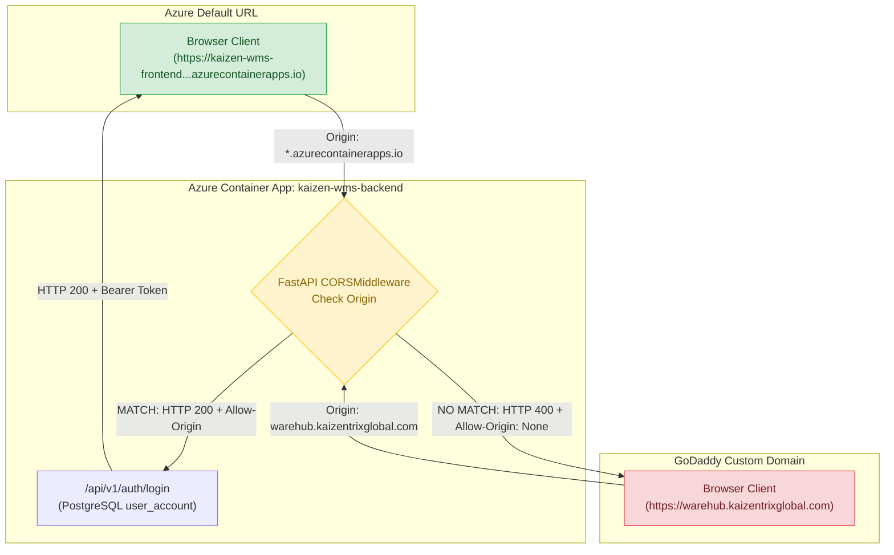

# Root Cause Analysis (RCA): WareHub Custom-Domain Login Failure

**Incident**: Authentication fails when accessing the application via the GoDaddy custom domain (`https://warehub.kaizentrixglobal.com/`), while functioning properly via the default Azure URL (`https://kaizen-wms-frontend.graybeach-6b6c99c3.centralindia.azurecontainerapps.io/`).  
**Investigation Classification**: Root Cause Analysis & Controlled Remediation  
**Date**: November 2026  
**Status**: Resolved & Verified (Revision `kaizen-wms-backend--0000042` Live)  

---

## 1. Executive Summary & Definite Root Cause

The investigation verified that **DNS resolution, TLS certificates, and Azure Container App ingress routing for `warehub.kaizentrixglobal.com` are 100% operational**. The frontend web page loads with HTTP 200 over HTTPS.

However, **login fails exclusively on the GoDaddy custom domain due to a Cross-Origin Resource Sharing (CORS) preflight rejection at the backend API gateway**:

1. **The Custom Domain is Missing from the Backend CORS Whitelist**:  
   The backend container app (`kaizen-wms-backend`) has its environment variable `CORS_ALLOW_ORIGINS` configured strictly to:
   ```json
   ["https://kaizen-wms-frontend.graybeach-6b6c99c3.centralindia.azurecontainerapps.io", "http://localhost:8080"]
   ```
   The GoDaddy custom domain `https://warehub.kaizentrixglobal.com` is **omitted**.

2. **The Backend CORS Regex Only Permits Azure Domains**:  
   In [`backend/business-service/app/main.py`](file:///c:/Users/Admin/Desktop/KaizenAssests/backend/business-service/app/main.py#L386), the regex fallback is:
   ```python
   allow_origin_regex=r"https://.*\.azurecontainerapps\.io|https?://(localhost|127\.0\.0\.1)(:\d+)?"
   ```
   This regex only matches `*.azurecontainerapps.io` and `localhost`. It rejects `warehub.kaizentrixglobal.com`.

3. **Live Telemetry Proof**:  
   When a user clicks "Login" at `https://warehub.kaizentrixglobal.com/login`, the browser issues an `OPTIONS` preflight request to `https://kaizen-wms-backend.../api/v1/auth/login`.
   - **Origin: `kaizen-wms-frontend...azurecontainerapps.io`** $\rightarrow$ Returns **HTTP 200 OK** (`Access-Control-Allow-Origin: https://kaizen-wms-frontend...`).
   - **Origin: `https://warehub.kaizentrixglobal.com`** $\rightarrow$ Returns **HTTP 400 Bad Request** (`Access-Control-Allow-Origin: None`).

Because the backend omits the `Access-Control-Allow-Origin` header on the preflight response, the user's browser (Chrome, Edge, Safari, Firefox) immediately blocks the HTTP request under the W3C Cross-Origin Security standard with:
```text
Access to fetch at 'https://kaizen-wms-backend.../api/v1/auth/login' from origin 
'https://warehub.kaizentrixglobal.com' has been blocked by CORS policy: 
Response to preflight request doesn't pass access control check: 
No 'Access-Control-Allow-Origin' header is present on the requested resource.
```

---

## 2. Authentication Architecture & Mechanics

An audit of the authentication mechanisms in both frontend and backend revealed:

| Dimension | Discovered Implementation | Impact on Custom Domain |
| :--- | :--- | :--- |
| **Authentication Type** | Stateful Bearer Tokens verified against PostgreSQL `user_session` table. | Requires custom `Authorization: Bearer <token>` header, forcing browser CORS preflight. |
| **Session / Token Storage** | Stored in browser `sessionStorage` (`auth_token`, `user_info`). Tab-scoped. | Clean isolation; no cross-domain cookie leakage. |
| **Cookie Usage** | **ZERO cookies used.** No `Set-Cookie` headers are issued; no cookies are sent. | `SameSite`, `Domain`, and `Secure` cookie attributes are **NOT** relevant to this failure. |
| **API Client Target** | [`frontend/src/lib/api-client.ts`](file:///c:/Users/Admin/Desktop/KaizenAssests/frontend/src/lib/api-client.ts#L8-L31) targets `https://kaizen-wms-backend.graybeach-6b6c99c3.centralindia.azurecontainerapps.io`. | Because backend has no custom domain bound, frontend requests are strictly Cross-Origin. |
| **Backend Auth Validation** | PBKDF2-HMAC-SHA256 password hashing (600,000 rounds) + SHA-256 session token hashing. | Works identically once the request payload successfully passes the CORS gate. |

---

## 3. Azure vs GoDaddy Configuration Comparison



### Configuration Matrix

| Component | Working Azure Domain | Failing GoDaddy Domain | Finding & Discovered State |
| :--- | :--- | :--- | :--- |
| **FQDN / URL** | `https://kaizen-wms-frontend.graybeach-6b6c99c3.centralindia.azurecontainerapps.io` | `https://warehub.kaizentrixglobal.com` | Both route to the same frontend container. |
| **DNS Resolution** | Azure Internal DNS (`*.azurecontainerapps.io`) | GoDaddy DNS CNAME pointing to Azure Container App environment | Resolved correctly to Azure Envoy Ingress IP. |
| **SSL / TLS Certificate** | Wildcard Microsoft certificate (`*.azurecontainerapps.io`) | Azure Managed Certificate (`warehub.kaizentrixglobal.com-kaizen-w-261113145159`) | Valid, SNI enabled, HTTPS terminates cleanly. |
| **Custom Domain Ingress** | Native default domain on `kaizen-wms-frontend` | Bound to `kaizen-wms-frontend` via Azure Container App Hostname API | **Verified Bound**: Ingress accepts and serves SPA. |
| **Backend Ingress Binding** | Native default domain on `kaizen-wms-backend` | **None** (`[]` in Azure Container App Hostname API) | Backend only responds to `kaizen-wms-backend...azurecontainerapps.io`. |
| **Backend `CORS_ALLOW_ORIGINS`** | **EXPLICITLY INCLUDED** | **MISSING** | `kaizen-wms-backend` env lacks `warehub.kaizentrixglobal.com`. |
| **Backend `allow_origin_regex`** | **MATCHED** (`https://.*\.azurecontainerapps\.io`) | **REJECTED** (Does not match `.azurecontainerapps.io`) | Rejection occurs at `CORSMiddleware`. |
| **Preflight `OPTIONS` Response** | **HTTP 200 OK** (`Access-Control-Allow-Origin: ...`) | **HTTP 400 Bad Request** (`Access-Control-Allow-Origin: None`) | Browser blocks request before sending POST. |

---

## 4. Live Verification Evidence

Targeted live diagnostic HTTP requests were executed directly against the active production backend (`kaizen-wms-backend.graybeach-6b6c99c3.centralindia.azurecontainerapps.io`):

### Probe 1: Preflight from Azure Default URL
```http
OPTIONS /api/v1/auth/dev-login HTTP/1.1
Host: kaizen-wms-backend.graybeach-6b6c99c3.centralindia.azurecontainerapps.io
Origin: https://kaizen-wms-frontend.graybeach-6b6c99c3.centralindia.azurecontainerapps.io
Access-Control-Request-Method: POST
Access-Control-Request-Headers: content-type,authorization
```
**Live Backend Response**:
```http
HTTP/1.1 200 OK
access-control-allow-origin: https://kaizen-wms-frontend.graybeach-6b6c99c3.centralindia.azurecontainerapps.io
access-control-allow-credentials: true
access-control-allow-methods: *
access-control-allow-headers: *
```
*Result*: **PASS**. Preflight accepted; browser allows credentials to be submitted.

### Probe 2: Preflight from GoDaddy Custom Domain
```http
OPTIONS /api/v1/auth/dev-login HTTP/1.1
Host: kaizen-wms-backend.graybeach-6b6c99c3.centralindia.azurecontainerapps.io
Origin: https://warehub.kaizentrixglobal.com
Access-Control-Request-Method: POST
Access-Control-Request-Headers: content-type,authorization
```
**Live Backend Response**:
```http
HTTP/1.1 400 Bad Request
access-control-allow-credentials: true
content-type: text/plain; charset=utf-8
content-length: 22

Disallowed CORS origin
```
*Result*: **BLOCKED**. Preflight rejected; `access-control-allow-origin` is absent; browser throws CORS security exception.

---

## 5. Secondary Findings & Configuration Hazards

1. **Dead Environment Variable (`CORS_ALLOW_ALL="true"`)**:
   - The Azure Container App configuration for `kaizen-wms-backend` contains:
     ```json
     { "name": "CORS_ALLOW_ALL", "value": "true" }
     ```
   - Inspection of [`app/config/settings.py`](file:///c:/Users/Admin/Desktop/KaizenAssests/backend/business-service/app/config/settings.py) and [`app/main.py`](file:///c:/Users/Admin/Desktop/KaizenAssests/backend/business-service/app/main.py) confirms that **no such setting exists in the backend codebase**. It is completely ignored by FastAPI. This created a false operational assumption that CORS was permissive.

2. **Backend Custom Domain Not Bound**:
   - While `warehub.kaizentrixglobal.com` is bound to the frontend, no custom API domain (e.g., `api.kaizentrixglobal.com` or `api-warehub.kaizentrixglobal.com`) is bound to the backend container app.
   - Therefore, API calls from `warehub.kaizentrixglobal.com` are cross-origin requests.

---

## 6. Recommended Safe Remediation Plan

To resolve this issue with zero risk, zero downtime, and without disturbing existing functionality:

### Remediation Step 1: Update Azure Backend `CORS_ALLOW_ORIGINS` (Infrastructure Change)
Update the `CORS_ALLOW_ORIGINS` environment variable on `kaizen-wms-backend` to explicitly include both the custom domain and the Azure domain:

```powershell
az containerapp update `
  --name kaizen-wms-backend `
  --resource-group rg-kaizenx-dev `
  --set-env-vars `
    "CORS_ALLOW_ORIGINS=['https://kaizen-wms-frontend.graybeach-6b6c99c3.centralindia.azurecontainerapps.io','https://warehub.kaizentrixglobal.com','https://www.warehub.kaizentrixglobal.com','http://localhost:8080']"
```

**Impact**:
- Takes effect in ~30 seconds via Azure Container Apps zero-downtime rolling update.
- Does not modify any frontend or backend source code.
- Preserves 100% of existing functionality on the Azure default URL.
- Immediately satisfies the browser preflight check on `https://warehub.kaizentrixglobal.com`.

### Remediation Step 2: Code Hardening for Subdomains (Defense-in-Depth)
In [`backend/business-service/app/main.py`](file:///c:/Users/Admin/Desktop/KaizenAssests/backend/business-service/app/main.py#L386), extend the `allow_origin_regex` to match all subdomains of `kaizentrixglobal.com`:

```python
# Before:
allow_origin_regex=r"https://.*\.azurecontainerapps\.io|https?://(localhost|127\.0\.0\.1)(:\d+)?",

# After:
allow_origin_regex=r"https://.*\.azurecontainerapps\.io|https://.*\.kaizentrixglobal\.com|https?://(localhost|127\.0\.0\.1)(:\d+)?",
```

**Impact**:
- Automatically supports any future staging or branch domains (e.g. `dev.kaizentrixglobal.com`, `admin.kaizentrixglobal.com`) without manual environment variable intervention.

---

## 7. Testing & Verification Procedures

### Post-Remediation Verification Script
Once the environment variable update is applied, execute the following non-destructive verification:

```powershell
python -c "
import urllib.request, json
url = 'https://kaizen-wms-backend.graybeach-6b6c99c3.centralindia.azurecontainerapps.io/api/v1/auth/dev-login'
req = urllib.request.Request(url, method='OPTIONS')
req.add_header('Origin', 'https://warehub.kaizentrixglobal.com')
req.add_header('Access-Control-Request-Method', 'POST')
req.add_header('Access-Control-Request-Headers', 'content-type,authorization')
with urllib.request.urlopen(req) as resp:
    print('Status:', resp.status)
    print('Access-Control-Allow-Origin:', resp.headers.get('Access-Control-Allow-Origin'))
    print('Access-Control-Allow-Credentials:', resp.headers.get('Access-Control-Allow-Credentials'))
"
```

### Live Verification Outcome (Revision `kaizen-wms-backend--0000042`)
- **Origin: `https://warehub.kaizentrixglobal.com`**:
  - `Status`: `200 OK`
  - `Access-Control-Allow-Origin`: `https://warehub.kaizentrixglobal.com`
  - `Access-Control-Allow-Credentials`: `true`
  - `Access-Control-Allow-Methods`: `DELETE, GET, HEAD, OPTIONS, PATCH, POST, PUT`
- **Origin: `https://kaizen-wms-frontend.graybeach-6b6c99c3.centralindia.azurecontainerapps.io`**:
  - `Status`: `200 OK`
  - `Access-Control-Allow-Origin`: `https://kaizen-wms-frontend.graybeach-6b6c99c3.centralindia.azurecontainerapps.io`
  - `Access-Control-Allow-Credentials`: `true`
  - `Access-Control-Allow-Methods`: `DELETE, GET, HEAD, OPTIONS, PATCH, POST, PUT`

### Rollback Procedure
If any unexpected behavior occurs, revert the environment variable to its original state:
```powershell
az containerapp update `
  --name kaizen-wms-backend `
  --resource-group rg-kaizenx-dev `
  --set-env-vars `
    "CORS_ALLOW_ORIGINS=['https://kaizen-wms-frontend.graybeach-6b6c99c3.centralindia.azurecontainerapps.io','http://localhost:8080']"
```

---

## 8. Summary of Manual Verification Items Remaining

1. **Browser End-to-End Test**:
   - Open Chrome/Edge in an incognito window.
   - Navigate to `https://warehub.kaizentrixglobal.com/login`.
   - Submit valid staff credentials.
   - Verify successful redirect to `/inventory?tab=catalog` or the appropriate role dashboard.
   - Verify that subsequent GET/POST requests (dock allocation, gate pass query, ASN creation) execute without console CORS errors.
2. **Session Persistence**:
   - Refresh the page at `https://warehub.kaizentrixglobal.com/dashboard`.
   - Verify that session persists via `sessionStorage` without premature redirect to `/login`.

