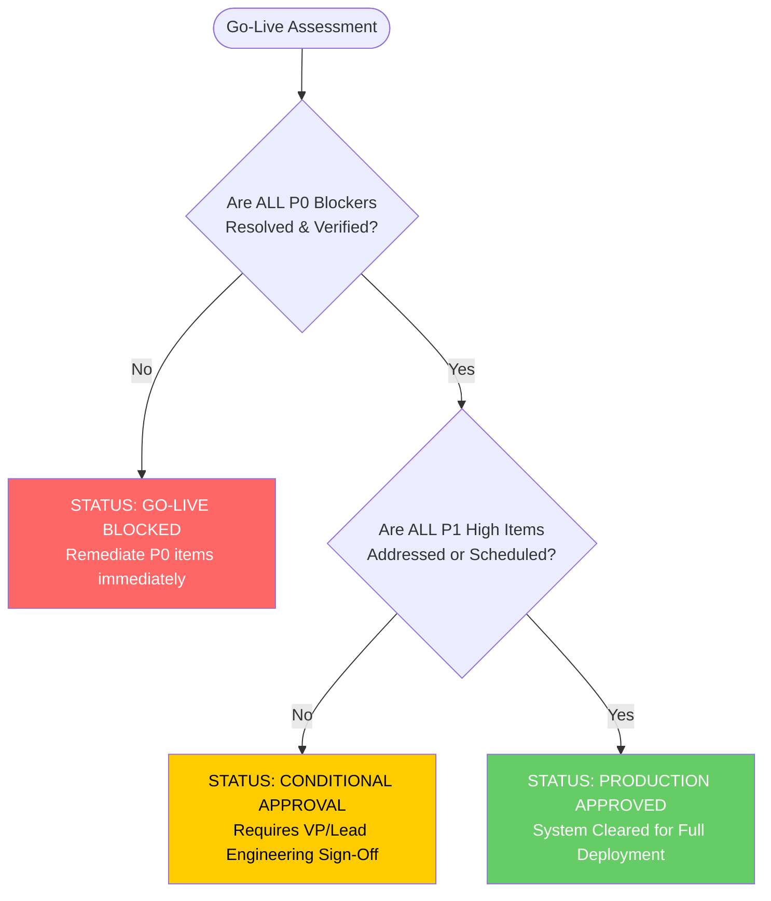

# WMS Application Production-Readiness & Go-Live Checklist

**Project**: Kaizen Warehouse Management System (WMS)  
**Target Environment**: Microsoft Azure Container Apps & PostgreSQL Flexible Server  
**Classification**: Enterprise Production Hardening & Verification Checklist  
**Version**: 1.0.0 (Post-Audit Edition)  

---

## 1. How to Use This Checklist

This checklist provides a structured, verifiable gate for moving the Kaizen WMS from its current **Conditional (Non-Production)** state to an **Enterprise Production-Ready** state.

### Severity & Priority Definitions
- **P0 (Blocker)**: Critical risk. Blocks production deployment; must be resolved and verified before accepting real warehouse data or users.
- **P1 (High)**: Major architectural, security, or reliability defect. Must be remediated in Sprint 1 following initial deployment.
- **P2 (Medium)**: Operational, observability, or defense-in-depth gap. Remediate within 30 days of go-live.
- **P3 (Low)**: Best practice, cosmetic, or non-functional polish item. Remediate as continuous improvement.

### Compliance Statuses
- `COMPLIANT`: Fully adheres to enterprise production standards with verified evidence.
- `PARTIAL`: Partially implemented or effective in dev/test, but lacking complete production enforcement.
- `NON-COMPLIANT`: Missing, broken, or misconfigured; requires immediate action.
- `N/A`: Not applicable to the current architecture.

---

## Domain 1: Frontend Security & Session Governance

| Check ID | Validation Item | Status | Priority | Discovered State & Technical Evidence | Required Action / Remediation | Go-Live Sign-Off Criteria |
| :--- | :--- | :---: | :---: | :--- | :--- | :--- |
| **FE-SEC-01** | Client Token Storage Isolation | `COMPLIANT` | P1 | Tokens and auth state stored in `sessionStorage` (`ams_auth_token`). Restricted to active browser tab. | Maintain tab-scoped session storage. Ensure tokens are wiped upon explicit logout. | Verified token isolation across tabs; zero tokens in unencrypted `localStorage`. |
| **FE-SEC-02** | Automatic Inactivity Session Timeout | `NON-COMPLIANT` | P1 | No idle timer (`mousemove`, `keydown`, `touchstart`). Warehouse terminal stays logged in indefinitely if tab is kept open. | Implement `useIdleTimer` hook (e.g. 15-minute threshold) with warning modal and auto-redirect to `/login`. | Session terminates and wipes storage after 15 minutes of zero user activity. |
| **FE-SEC-03** | Route Guard Enforcement | `COMPLIANT` | P0 | TanStack Router `beforeLoad` hooks enforce `requireRouteAccess()` and `getPageAccess()`. | Continue enforcing route checks on all client transitions. | Direct URL navigation to `/warehouse/*`, `/gate/*`, `/supplier/*` redirects unauthenticated users to `/login`. |
| **FE-SEC-04** | Client Security Headers Injection | `COMPLIANT` | P0 | Nitro SSR response wrapper in `frontend/src/server.ts` injects `X-Frame-Options: DENY`, `X-Content-Type-Options: nosniff`, `Referrer-Policy`, `Strict-Transport-Security`, and `Content-Security-Policy`. | Maintain security header injection in SSR handler; verify against staging endpoint. | `curl -I <frontend_url>` returns `Strict-Transport-Security`, `X-Frame-Options: DENY`, `X-Content-Type-Options: nosniff`. |
| **FE-SEC-05** | Internal Role Header Stripping | `NON-COMPLIANT` | P2 | Frontend API client attaches `X-User-Roles`, `X-User-Username` headers to outbound requests. | Strip custom authorization headers from frontend client; rely solely on `Authorization: Bearer <token>`. | Browser DevTools network trace verifies no `X-User-*` headers sent on production requests. |

---

## Domain 2: Frontend UX, Validation & Error Handling

| Check ID | Validation Item | Status | Priority | Discovered State & Technical Evidence | Required Action / Remediation | Go-Live Sign-Off Criteria |
| :--- | :--- | :---: | :---: | :--- | :--- | :--- |
| **FE-UX-01** | Duplicate Submission Prevention | `COMPLIANT` | P1 | Critical action buttons (`Submit ASN`, `Generate Gate Pass`, `Complete GRN`) set `disabled={isSubmitting}` during active mutations. | Maintain button disable state and loading spinners across all form actions. | Rapid double-clicks produce exactly 1 HTTP POST request and 0 duplicate records. |
| **FE-UX-02** | Input Validation & Schema Enforcement | `COMPLIANT` | P1 | Zod schemas and React Hook Form validate material quantities, driver phone numbers, vehicle registrations, and dates. | Maintain client schemas. Ensure boundary conditions (negative values, 0 quantities) are caught client-side. | Invalid inputs display instant inline red validation messages without submitting to backend. |
| **FE-UX-03** | Fluid Grid Alignment on Form Elements | `PARTIAL` | P3 | Shipped Material quantity input wraps or shrinks irregularly on medium screens; search input overlaps table title in Gate module. | Apply `min-w-[120px]`, `flex-shrink-0`, and responsive grid breakpoints (`grid-cols-1 md:grid-cols-4`) to form controls. | UI layout displays perfectly aligned inputs across 1024px, 1280px, and 1920px viewports. |
| **FE-UX-04** | Global API Error Boundary & Toast Alerts | `COMPLIANT` | P2 | Sonner toast notifications and TanStack error boundaries catch failed API responses and display readable error messages. | Ensure generic 500 error envelopes don't leak raw database trace strings to users. | User sees clean error toasts ("Vehicle already registered" / "Connection lost") on server failures. |

---

## Domain 3: Backend API Security & Access Control

| Check ID | Validation Item | Status | Priority | Discovered State & Technical Evidence | Required Action / Remediation | Go-Live Sign-Off Criteria |
| :--- | :--- | :---: | :---: | :--- | :--- | :--- |
| **BE-SEC-01** | Production Authentication Gating | `COMPLIANT` | P0 | `router.py` and `dependencies.py` updated. Database session authentication (`user_session` lookup) now active in production mode without requiring dev environment bypass. | Deploy updated backend container image and verify production login. | Backend boots with `ENVIRONMENT=production`, and users log in successfully via `/dev-login` and `/supplier-login`. |
| **BE-SEC-02** | Auth Endpoint Rate Limiting | `NON-COMPLIANT` | P0 | Zero rate limiting on `/dev-login`, `/supplier-login`, or `/magic-login`. Susceptible to credential stuffing. | Implement `slowapi` rate limiter (e.g., 5 attempts per minute per IP) or Azure Front Door WAF rate limiting rule. | Rapid successive POSTs (>5 in 60s) receive HTTP 429 Too Many Requests. |
| **BE-SEC-03** | Role-Based Access Control (RBAC) | `COMPLIANT` | P0 | Router dependencies enforce permissions (`gate:write`, `storage:read`, `receiving:write`) via `require_permission()`. | Maintain granular permission dependencies on all state-changing endpoints. | User with `SUPPLIER` role attempting to call `/api/v1/warehouse/zones` receives HTTP 403 Forbidden. |
| **BE-SEC-04** | CORS Whitelisting Hardening | `PARTIAL` | P1 | Allowed origins include regex `r"https://.*\.azurecontainerapps\.io"` and localhost fallbacks. | Restrict `cors_allow_origins` strictly to the exact deployed frontend FQDN and custom production domain. | Pre-flight OPTIONS from unauthorized domain returns HTTP 400/403 with no `Access-Control-Allow-Origin`. |
| **BE-SEC-05** | API Documentation Exposure | `PARTIAL` | P2 | Swagger UI enabled at `/docs` in `dev` mode. `validate_production_security` requires disabling docs in production. | Ensure `ENABLE_API_DOCS=false` when setting `ENVIRONMENT=production`. | Accessing `https://<backend_url>/docs` and `/redoc` returns HTTP 404. |

---

## Domain 4: Backend Reliability, Data Validation & Concurrency

| Check ID | Validation Item | Status | Priority | Discovered State & Technical Evidence | Required Action / Remediation | Go-Live Sign-Off Criteria |
| :--- | :--- | :---: | :---: | :--- | :--- | :--- |
| **BE-REL-01** | Transactional Unit of Work (UoW) | `COMPLIANT` | P0 | `UnitOfWork` context manager in `app/database/session.py` commits on exit and automatically rolls back on exceptions. | Ensure all multi-entity mutations (e.g. ASN item creation, GRN batch generation) run inside `async with UnitOfWork()`. | Throwing an intentional mock error inside a service call leaves 0 orphan records in child tables. |
| **BE-REL-02** | Centralized Exception Handling | `COMPLIANT` | P1 | `register_exception_handlers` intercepts `RequestValidationError`, `IntegrityError`, and `HTTPException` with correlation IDs. | Maintain standard error schema `{detail, code, request_id}` across all modules. | All API errors return JSON response with HTTP status code and non-null `request_id`. |
| **BE-REL-03** | Startup Runtime DDL Retirement | `COMPLIANT` | P0 | `app/main.py` gates runtime `ALTER TABLE` statements behind `settings.startup_schema_compatibility`. In production (`startup_schema_compatibility=False`), runtime DDL is completely bypassed. | Ensure `STARTUP_SCHEMA_COMPATIBILITY=false` in production container app configuration. | Backend starts cleanly with 0 DDL statements logged in PostgreSQL query logs. |
| **BE-REL-04** | Persistent Multi-Replica File Storage | `PARTIAL` | P0 | `AzureBlobStorageService` in `app/services/storage.py` upgraded with Managed Identity support and local backward-compatibility; awaiting Azure Storage Account provisioning. | Provision Azure Blob container and set connection string or Managed Identity account URL in backend container. | File uploaded to backend replica 1 is immediately viewable when fetched through backend replica 2. |

---

## Domain 5: WMS Business Workflow & Domain Rules Integrity

| Check ID | Validation Item | Status | Priority | Discovered State & Technical Evidence | Required Action / Remediation | Go-Live Sign-Off Criteria |
| :--- | :--- | :---: | :---: | :--- | :--- | :--- |
| **WMS-DOM-01** | GRN Quantity Conservation Rule | `COMPLIANT` | P0 | Quality inspection requires $\text{Received Qty} = \text{Accepted Qty} + \text{Rejected Qty}$. Over-acceptance rejected. | Retain invariant checks at domain service layer before persisting inspection results. | API call submitting accepted + rejected > received returns HTTP 400/422 validation error. |
| **WMS-DOM-02** | Putaway Capacity & Rack Allocation | `COMPLIANT` | P0 | Putaway validates target bin weight and volume limits; updates `inventory_location_balance` under row lock. | Maintain row locking during putaway execution to avoid race conditions. | Two concurrent putaways to a bin with capacity 100 reject the second request if total exceeds 100. |
| **WMS-DOM-03** | Damage Claim Segregation & Evidence | `COMPLIANT` | P1 | Damaged items generate segregated damage claim tickets with mandatory photo attachments and supplier notification. | Ensure damage claims link to valid ASN line items and persist photos to Blob Storage. | Damage claim creation persists claim record, links photos, and triggers supplier notification event. |
| **WMS-DOM-04** | ASN Number Sequence Uniqueness | `COMPLIANT` | P0 | ASN numbers generated with year-prefixed sequences (`ASN-2026-006`) with unique constraints in PostgreSQL. | Maintain unique constraint on `advance_shipping_notice.asn_number`. | Attempt to insert duplicate ASN number raises unique constraint violation cleanly handled by API. |

---

## Domain 6: PostgreSQL Database Schema, Constraints & Indexing

| Check ID | Validation Item | Status | Priority | Discovered State & Technical Evidence | Required Action / Remediation | Go-Live Sign-Off Criteria |
| :--- | :--- | :---: | :---: | :--- | :--- | :--- |
| **DB-SCH-01** | Primary Key & UUID Consistency | `COMPLIANT` | P0 | All 119 base tables define explicit primary keys (UUID or BIGINT). | Continue using UUID primary keys for distributed and multi-tenant entities. | Zero tables with missing primary keys. |
| **DB-SCH-02** | Foreign Key Referential Integrity | `COMPLIANT` | P0 | Foreign keys enforce cascading or restrict behaviors across ASN, Gate, GRN, Putaway, and Storage tables. | Maintain foreign key constraints in all future Alembic migrations. | Deleting a parent record with active child entities correctly raises foreign key violation. |
| **DB-SCH-03** | Index Coverage on Lookup Keys | `COMPLIANT` | P1 | 469 B-tree indexes cover business document codes (`gate_pass_number`, `asn_number`), foreign keys, and status flags. | Maintain index strategy; avoid redundant indexes on low-cardinality boolean columns. | Query plans for document searches show `Index Scan` rather than `Seq Scan`. |
| **DB-SCH-04** | Audit Log Table Partitioning / Curation | `NON-COMPLIANT` | P1 | `system_audit_log` has 29,300+ rows; table logs all HTTP GET requests, causing massive unpartitioned table bloat. | Add monthly table partitioning on `created_at` or purge audit logs older than 90 days; stop logging GET requests. | Audit log table size remains bounded; read requests no longer generate audit log rows. |

---

## Domain 7: Database Security, Isolation & Access Control

| Check ID | Validation Item | Status | Priority | Discovered State & Technical Evidence | Required Action / Remediation | Go-Live Sign-Off Criteria |
| :--- | :--- | :---: | :---: | :--- | :--- | :--- |
| **DB-SEC-01** | Network Firewall Hardening | `NON-COMPLIANT` | P0 | Firewall rule `AllowAllIPs` set to `0.0.0.0 - 255.255.255.255`. Port 5432 is completely open to the internet. | Delete `AllowAllIPs` rule; whitelist only the outbound IPs of Azure Container Apps or configure VNet integration. | External connection attempt to `kaizen-wms-psql.postgres.database.azure.com:5432` from local PC is blocked. |
| **DB-SEC-02** | Encryption in Transit (TLS Enforcement) | `COMPLIANT` | P0 | PostgreSQL server parameter `require_secure_transport = ON`. Connections require TLS 1.2+. | Enforce `sslmode=verify-full` or `ssl=verify-full` in backend database connection string. | Plaintext connection attempts to PostgreSQL are rejected by the server. |
| **DB-SEC-03** | Password Hashing & Secret Protection | `COMPLIANT` | P0 | User passwords hashed using PBKDF2-HMAC-SHA256 with 600,000 rounds. No plaintext passwords stored in database. | Maintain 600,000 iteration threshold for password hashing. | Password column inspection confirms salted PBKDF2 strings across all user accounts. |
| **DB-SEC-04** | Least-Privilege DB User Permissions | `PARTIAL` | P2 | Backend connects using administrative database user `kaizenadmin`. | Create a dedicated unprivileged application user (`kaizen_app_user`) granted DML only (SELECT, INSERT, UPDATE, DELETE). | Application user cannot execute DDL commands (`DROP TABLE`, `CREATE EXTENSION`). |

---

## Domain 8: Azure Cloud Infrastructure & Network Hardening

| Check ID | Validation Item | Status | Priority | Discovered State & Technical Evidence | Required Action / Remediation | Go-Live Sign-Off Criteria |
| :--- | :--- | :---: | :---: | :--- | :--- | :--- |
| **AZ-INF-01** | Azure Key Vault Secret Management | `NON-COMPLIANT` | P0 | Database connection string stored in plaintext in Container App revision template. No Key Vault deployed. | Provision Azure Key Vault; store `DATABASE-URL` as secret; reference Key Vault secret from Container App secret store. | No credentials or passwords visible in `az containerapp show` JSON output. |
| **AZ-INF-02** | Managed Identity Enablement | `NON-COMPLIANT` | P1 | Both Container Apps have `identity: None`. | Enable System-Assigned Managed Identity on backend Container App; grant IAM roles for Key Vault and Blob Storage. | Backend connects to Azure Key Vault and Storage using `DefaultAzureCredential()` without static keys. |
| **AZ-INF-03** | Container App Health Probes | `NON-COMPLIANT` | P1 | Container Apps template defines `probes: null`. Azure cannot detect deadlocked or unhealthy containers. | Configure HTTP liveness probe (`/health/live`) and readiness probe (`/health/ready`) on port 8080. | ACA restarts failed containers automatically when health endpoint returns non-200. |
| **AZ-INF-04** | Custom Domain & TLS Certificate | `PARTIAL` | P2 | Application operates on default `*.azurecontainerapps.io` domain with standard Microsoft managed wildcard cert. | Bind enterprise custom domain (e.g. `wms.kaizentrix.com`) with automated Azure Managed Certificate. | Users access application via official company domain over HTTPS with valid SSL certificate. |

---

## Domain 9: Disaster Recovery, Backups & Business Continuity

| Check ID | Validation Item | Status | Priority | Discovered State & Technical Evidence | Required Action / Remediation | Go-Live Sign-Off Criteria |
| :--- | :--- | :---: | :---: | :--- | :--- | :--- |
| **DR-BC-01** | Point-in-Time Recovery (PITR) | `COMPLIANT` | P0 | PostgreSQL Flexible Server PITR enabled with 7-day retention in locally redundant backup storage. | Maintain PITR retention. Consider increasing to 14 or 30 days for regulatory compliance. | Azure Portal allows point-in-time restore to any minute within the past 7 days. |
| **DR-BC-02** | PostgreSQL Storage Auto-Grow | `NON-COMPLIANT` | P0 | `autoGrow: Disabled` on 32GB disk. If disk fills up, database enters read-only lockdown. | Enable storage auto-grow (`az postgres flexible-server update --storage-auto-grow Enabled`). | `az postgres flexible-server show` displays `"storage": {"autoGrow": "Enabled"}`. |
| **DR-BC-03** | Geo-Redundant Backup Strategy | `NON-COMPLIANT` | P2 | `geoRedundantBackup: Disabled`. Catastrophic Central India region loss results in downtime until region recovers. | Enable Geo-redundant backups for critical production environments or maintain automated pg_dump exports to secondary region. | Backup metadata indicates secondary region replication is active. |
| **DR-BC-04** | Disaster Recovery Restoration Drill | `NON-COMPLIANT` | P1 | No documented or tested disaster recovery runbook for restoring PostgreSQL snapshot to a secondary test server. | Perform a documented test restore of `kaizen-wms-psql` to a temporary server and verify data integrity. | Documented test restore completed in <30 minutes with 100% data verification. |

---

## Domain 10: Scalability, Performance & Resource Sizing

| Check ID | Validation Item | Status | Priority | Discovered State & Technical Evidence | Required Action / Remediation | Go-Live Sign-Off Criteria |
| :--- | :--- | :---: | :---: | :--- | :--- | :--- |
| **PERF-01** | Database Compute Tier Sizing | `PARTIAL` | P1 | Database provisioned on `Standard_B2s` (burstable). Heavy warehouse activity can deplete CPU credits and throttle performance. | Upgrade database tier to `Standard_D2ds_v5` (General Purpose, dedicated CPU) before full production rollout. | Database CPU utilization remains stable under simulated 200 concurrent user load. |
| **PERF-02** | Connection Pooling Configuration | `COMPLIANT` | P0 | AsyncPG connection pool configured with `pool_size=15`, `max_overflow=20`, `pool_recycle=1800`, `pool_pre_ping=True`. | Maintain current connection pool sizing; ensure total connections do not exceed PostgreSQL `max_connections` (50 on B2s). | Backend handles sudden bursts of concurrent API calls without connection timeout errors. |
| **PERF-03** | Asynchronous Audit Log Middleware | `COMPLIANT` | P1 | `AuditLogMiddleware` in `app/middleware/audit_log.py` excludes read-only GET/OPTIONS requests and schedules state-changing audit writes via non-blocking `asyncio.create_task`. | Maintain GET exclusion; monitor `system_audit_log` row growth rate in production. | HTTP GET request latency drops by >15ms; zero audit writes logged for read queries. |
| **PERF-04** | Container Horizontal Scaling Rules | `COMPLIANT` | P1 | Container Apps configured with `minReplicas=1`, `maxReplicas=2`, scaling on HTTP traffic rules. | Adjust `minReplicas=2` for high availability once Blob Storage is enabled for file uploads. | Traffic spike automatically scales container instances from 2 to 4 pods. |

---

## Domain 11: Operational Monitoring, Logging & Observability

| Check ID | Validation Item | Status | Priority | Discovered State & Technical Evidence | Required Action / Remediation | Go-Live Sign-Off Criteria |
| :--- | :--- | :---: | :---: | :--- | :--- | :--- |
| **MON-01** | Centralized Container Log Aggregation | `COMPLIANT` | P1 | Both frontend and backend containers stream stdout/stderr to Log Analytics `workspace-rgkaizenxdev2g4U`. | Maintain Log Analytics integration; configure saved KQL queries for error tracking. | Container exceptions and 5xx errors searchable in Azure Log Analytics within 60 seconds. |
| **MON-02** | APM Distributed Tracing (App Insights) | `PARTIAL` | P2 | Telemetry hooks exist in `app/logging/telemetry.py`, but `APPLICATIONINSIGHTS_CONNECTION_STRING` is not populated. | Deploy Azure Application Insights component; inject connection string into backend container environment. | App Insights displays full end-to-end distributed transaction map and slow SQL query breakdown. |
| **MON-03** | Operational Alert Rules | `NON-COMPLIANT` | P1 | No Azure Monitor alert rules configured for 5xx error rate spikes, container restarts, or PostgreSQL disk >80%. | Configure Azure Monitor metric alerts for: 1) DB CPU >80%, 2) DB Storage >80%, 3) Container HTTP 5xx >5%. | Synthetic error generation sends automated alert email/SMS to on-call engineers. |
| **MON-04** | Correlation ID (Request ID) Tracking | `COMPLIANT` | P1 | `RequestContextMiddleware` generates UUID `request_id` for every request, logging it across all log messages. | Maintain correlation ID logging across all services. | API response header `x-request-id` matches corresponding log entries in Log Analytics. |

---

## Domain 12: CI/CD Deployment, Release Safety & Rollback

| Check ID | Validation Item | Status | Priority | Discovered State & Technical Evidence | Required Action / Remediation | Go-Live Sign-Off Criteria |
| :--- | :--- | :---: | :---: | :--- | :--- | :--- |
| **CICD-01** | Automated Pipeline Validation | `COMPLIANT` | P0 | `.github/workflows/deploy.yml` builds containers via `az acr build`, deploys to ACA, and probes health endpoints. | Continue running automated tests and linters in `.github/workflows/ci.yml` before merge. | Deployment pipeline executes lint, unit tests, build, and deploy automatically on push to `main`. |
| **CICD-02** | Automated Deployment Rollback | `COMPLIANT` | P0 | Deploy workflow probes `/health/ready` and `/login`; automatically reverts Container App to previous revision on probe failure. | Maintain automated health probe verification in deploy pipeline. | Failed deployment automatically rolls back to stable revision in <90 seconds with zero downtime. |
| **CICD-03** | Production Database Migration Gate | `NON-COMPLIANT` | P0 | Deploy workflow updates container images directly; relies on runtime DDL in `lifespan` rather than running Alembic pre-deploy. | Add pre-deployment GitHub Actions job: `alembic upgrade head` using an ephemeral container before updating web app. | Database migrations execute and verify successfully prior to routing traffic to new application containers. |
| **CICD-04** | Container Image Vulnerability Scanning | `NON-COMPLIANT` | P2 | Basic ACR does not run automated vulnerability scanning on pushed container images. | Enable Microsoft Defender for Containers or integrate Trivy scanner into GitHub Actions build job. | Build fails or issues critical alert if container image contains High/Critical CVEs. |

---

## 2. Go-Live Sign-Off Decision Matrix

### Sign-Off Verification Table

| Sign-Off Gate | Target Criterion | Required Verifier | Verification Date | Signature / Status |
| :--- | :--- | :--- | :---: | :---: |
| **Security Gate** | P0 security items (DB Firewall, Auth Token, Secret Storage) resolved. | Security Lead / Architect | Pending Remediation | `PENDING` |
| **Infrastructure Gate** | PostgreSQL Auto-Grow enabled; Blob Storage configured; Health probes active. | Cloud Infrastructure Lead | Pending Remediation | `PENDING` |
| **Application Gate** | Runtime DDL retired; Audit logging filtered; Frontend security headers injected. | Full-Stack Lead Engineer | Pending Remediation | `PENDING` |
| **Executive Gate** | Final verification on production staging environment with synthetic load test. | VP of Engineering / Product Owner | Pending Remediation | `PENDING` |

---
*End of WMS Application Production Checklist. Refer to the comprehensive analysis in [WMS_ENTERPRISE_READINESS_AUDIT.md](file:///c:/Users/Admin/Desktop/KaizenAssests/docs/audit/WMS_ENTERPRISE_READINESS_AUDIT.md).*

